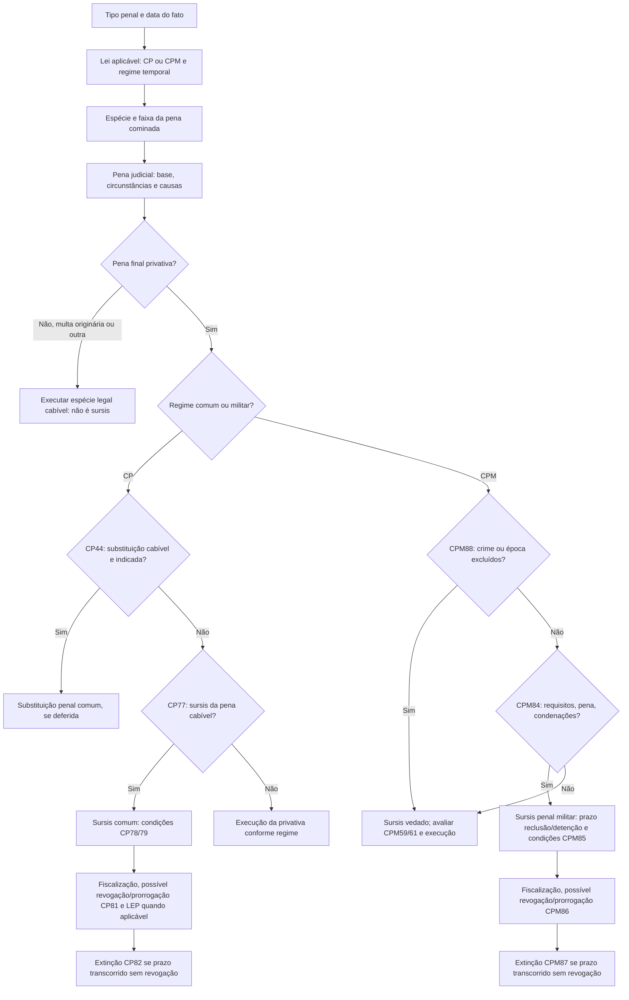

# T25.M03/T27 — Dossiê 14: sursis penal, fase processual e execução

**Data de corte:** 15/10/2026, America/Sao_Paulo. **Issue [#31](https://github.com/raphaelpetta/codigo-legislacao-federal/issues/31)**, **[PR #32, draft](https://github.com/raphaelpetta/codigo-legislacao-federal/pull/32)**, branch `modulo/T25-parte-geral-f0-f1`. **Corpus de direito vigente:** CP arts.77–82, CPM arts.84–88, LEP arts.2º e 156–163; interfaces CP44/163/167, CPM59/62/187/2023, Lei9.099/1995 arts.89/90-A, CPP28-A (ANPP). **Status:** F1–F4, `Q`; **não** há C0-J, C1 ou M aprovado e nenhuma integração à main.

## 1. Quatro eixos que não podem ser fundidos

**(A) Suspensão condicional da pena (sursis penal):** após a imposição de pena privativa; suspende-se sua **execução**, mediante condições e prazo. CP77–82 e CPM84–88 estabelecem pressupostos e efeitos diferentes.

**(B) Suspensão condicional do processo:** providência processual da Lei9.099/1995, art.89, distinta do sursis penal. O art.90-A exclui sua aplicação aos processos de Justiça Militar. [STJ, AgRg no HC916.829/MG, 2024, Informativo831](https://processo.stj.jus.br/jurisprudencia/externo/informativo/?acao=pesquisar&aplicacao=informativo&b=INFJ&i=375&l=25&livre=NAO+ESTANDO+&p=true&refinar=S.DISP.&t=), confirmou a vedação para fatos posteriores à Lei9.839/1999, independentemente da Justiça Militar federal ou estadual. Isso **não** significa proibição de sursis penal CPM84.

**(C) Acordo de não persecução penal (ANPP):** instituto consensual de processo penal do CPP28-A, não é sursis de pena e não equivale à suspensão condicional de processo. [STF, notícia oficial 06/05/2024 sobre julgamento em 26/04/2024](https://portal.stf.jus.br/noticias/verNoticiaDetalhe.asp?idConteudo=535561) reconheceu possibilidade de ANPP perante Justiça Militar; [STJ HC993.294/MG, julgamento 05/08/2025, Informativo857](https://processo.stj.jus.br/jurisprudencia/externo/informativo/?acao=pesquisarumaedicao&from=feed&livre=0857.cod.) acompanhou. Um acordo **não é automático**, depende de requisitos e avaliação apropriada do MP e controle judicial. **Não concluir** que todo delito militar, inclusive deserção, satisfaz os pressupostos. A [PSV149 em consulta pública desde 27/08/2026](https://noticias.stf.jus.br/postsnoticias/stf-abre-consulta-publica-sobre-acordos-de-nao-persecucao-penal-na-justica-militar/) **não** deve ser relatada como súmula vinculante aprovada; andamento posterior à consulta ainda Q.

**(D) Lei de Execução Penal — LEP:** a incidência do procedimento e direitos penitenciários não é sinônimo de ampliar direitos penais materiais de substituição. **LEP2 parágrafo único** torna-a aplicável a preso provisório e condenado pela Justiça Eleitoral/Militar **quando recolhido a estabelecimento sujeito à jurisdição ordinária**. A exceção de local de custódia deve orientar arquitetura T27; **não presumir que todo sursis na Justiça Militar transcorra pelo rito integral LEP156–163 em qualquer estabelecimento**, nem que militares estejam fora de garantias constitucionais.

### Fontes primárias, inspecionadas em 15/10/2026

1. [CP, Câmara — Decreto-Lei2.848/1940 compilado](https://www2.camara.leg.br/legin/fed/declei/1940-1949/decreto-lei-2848-7-dezembro-1940-412868-normaatualizada-pe.html), arts.77–82 e correlatos 44,163,167.
2. [CPM, Câmara — Decreto-Lei1.001/1969 compilado](https://www2.camara.leg.br/legin/fed/declei/1960-1969/decreto-lei-1001-21-outubro-1969-376258-normaatualizada-pe.html), arts.84–88, 59,62,187 e notas da **Lei14.688/2023**.
3. [Lei7.210/1984, Câmara, LEP atualizada](https://www2.camara.leg.br/legin/fed/lei/1980-1987/lei-7210-11-julho-1984-356938-normaatualizada-pl.html), arts.2º, 156–163.
4. Fontes judiciais [`JURISPRUDENCIA_E_ANPP_SURSIS_CICLO14.csv`](JURISPRUDENCIA_E_ANPP_SURSIS_CICLO14.csv), seis registros, de nível variável: decisão em HC por notícia/Informativo, ata STM, consulta PSV. **Não** atribuir efeito vinculante à consulta ou generalizar julgados isolados.

## 2. Lei comum × militar: direitos e obrigações diferentes

| Tema | CP77–82 | CPM84–88 (2026) | Risco no CLF |
|---|---|---|---|
| Pena ordinária elegível | Privativa até **2 anos** | Privativa até **2 anos**, sujeita ao CPM88 | Núcleo parcialmente comum |
| Prazo de prova | **2–4 anos** | **Reclusão 3–5; detenção 2–4 anos**, alteração 2023 | Unificar para 2–4 altera disciplina militar |
| Idade/saúde | >70 ou saúde: pena até **4 anos**, prova 4–6 | §2 CPM84 igualmente até 4, prova 4–6, **introduzido em 2023** | Efeito intertemporal e art88 |
| Condenação anterior | Não reincidente **doloso**; multa anterior não impede | Não deve ter condenação definitiva prévia **a privativa de liberdade**, ressalvada depuração CPM71 §1 | Diferença de alcance |
| Substituição | CP77 III exige não ser indicada/cabível restritiva CP44 | CPM59 oferece **conversão em prisão militar** quando sursis incabível; não a mesma hierarquia de benefício | Troca de pena não privativa por prisão é M |
| Condições | CP78 serviços comunitários/fim de semana e alternativa de reparação/condições; CP79 adicionais | CPM85 exige que sentença especifique condições; não reproduz CP78 | Importação automática é M |
| Exceção por tipo | Sem lista equivalente ao CPM88 | CPM88 veda sursis em guerra e em crimes de hierarquia, **deserção**, outros especificados | Apagar § por unificação aumenta benefícios (M) |
| Revogação obrigatória | CP81 I–III, inclusive inadimplemento doloso de multa ou violação CP78 §1 | CPM86 I–II; **inciso III revogado 2023** | Gatilhos de perda do benefício distintos |
| Revogação facultativa | CP81 §1 por outras violações ou condenação culposa/contravenção | CPM86 §1 inclui **infração disciplinar militar grave** (2023) | Disciplina funcional afeta pena |
| Prorrogação | CP81 §§2–3 | CPM86 §§2–3 | Semântica da causa de prorrogação difere |
| Término | CP82 extingue pena privativa sem revogação | CPM87 idem | Similaridade condicionada ao alcance |

**Ponto técnico determinante:** o CPM84 §2 ampliou desde 2023 o tratamento etário/saúde, mas não contém comando que afaste a **lista de exclusões do CPM88**. Não alegar que deserção recebeu sursis especial por idade, doença ou apenas porque a pena cabe no teto.

**Fonte instrumental:** [`INVENTARIO_SURSIS_CP_CPM_LEP_CICLO14.csv`](INVENTARIO_SURSIS_CP_CPM_LEP_CICLO14.csv) tem **20 artigos nominais e 61 subunidades descritivas** (CP77–82 = 6; CPM84–88 = 5; LEP2 e 156–163 = 9). Não é espelho literal C0-T e não comprova equivalência C0-J. [`MATRIZ_PORTAS_SURSIS_EXECUCAO_CICLO14.csv`](MATRIZ_PORTAS_SURSIS_EXECUCAO_CICLO14.csv) tem **30 interfaces Q/M potenciais**, inclusive processo e ANPP, não 30 revogações.

## 3. Fluxo de decisão — critérios que precisam ter o mesmo referente jurídico

**Nota ao desenho:** diagrama de decisão simplificado, **não** fluxo normativo exaustivo nem minuta regulamentar. Antes da condenação, a Justiça comum e a militar têm portas processuais próprias: suspensão de processo e ANPP devem constar de fluxo **separado de T26**, jamais como ramo de extinção da pena do T25. A existência de pena não privativa no CPM, outros benefícios, medidas de segurança ou evento intertemporal pode acrescentar ramificações.

## 4. Doze casos condicionados: o que muda no resultado

A [matriz `CASOS_PORTAS_EXECUCAO_CICLO14.csv`](CASOS_PORTAS_EXECUCAO_CICLO14.csv) usa 12 cenários com características fixadas, **sem condenações fabricadas**.

- **S14-01/02/03/04 — CP163 dano simples:** multa como pena **original** evita a questão do sursis; se detenção de quatro meses foi **hipoteticamente** aplicada, deve-se examinar substituição CP44 **antes** do sursis CP77 III. Se sursis excepcionalmente deferido, há prazo comum 2–4 anos, condições CP78 e audiência do regime LEP aplicável; descumprir condição obrigatória do primeiro ano pode provocar revogação **obrigatória** CP81 III, respeitada defesa e processo.
- **S14-05 — dano 2022:** usar versões vigentes em cada fato, sem inventar alteração de 2023 do CP a partir de reforma do CPM.
- **S14-06/07 — CPM187 deserção 2026:** não basta detenção curta e idade/saúde para sursis; CPM88 II a **veda** e CPM59 trata conversão penal de pena até dois anos aplicada a militar quando sursis é incabível. A prisão militar **é privação de liberdade**. Um ano ou 18 meses usados são números **didáticos**, não dosimetria de qualquer militar.
- **S14-08 — deserção 2022:** verificar redação anterior de CPM84/86 e lex mitior, sem presumir revogação da exclusão CPM88.
- **S14-09/10 — outro crime militar elegível:** quando o tipo não estiver na lista CPM88 e requisitos preenchidos, reclusão hipotética de um ano pode ter sursis **por 3–5 anos**, diferentemente do CP; **punição disciplinar grave** no sursis militar pode ensejar **revogação facultativa**, não obrigatória.
- **S14-11 — civil condenado pela Justiça Militar:** o local de cumprimento é decisivo para **LEP2 parágrafo único**; essa incidência não revoga a disciplina material penal militar e **civil não é autor de deserção** sem a condição típica exigida pelo CPM187.
- **S14-12 — estado pré-sentença:** sursis de execução de pena, suspensão do processo e ANPP são três portas diferentes; a exclusão da Lei9.099 no militar **não** extingue a possibilidade de ANPP admitida na jurisprudência recente.

## 5. Inovação jurisprudencial que impede abordagem exclusivamente proibitiva

Os ciclos 05–13 enfatizaram exceções penais militares. **Este ciclo encontrou uma convergência jurisprudencial processual que deve permanecer separada:** o STF e o STJ reconhecem a possível celebração de ANPP nos processos militares, mesmo que a Lei9.099/1995 art.90-A exclua a suspensão condicional do processo. Isso mostra que **especificidade penal militar não permite inferir aplicação ou exclusão de todo instituto comum pelo nome**; o comparador apropriado é a base normativa de cada instituto, competência, direito constitucional e entendimento atual do tribunal.

### Arquivos e qualidade da evidência

[`JURISPRUDENCIA_E_ANPP_SURSIS_CICLO14.csv`](JURISPRUDENCIA_E_ANPP_SURSIS_CICLO14.csv) contém 6 referências: STJ AgRg HC916829 (2024), STF ANPP Justiça Militar (2024), STJ HC993294 (2025), STF consulta PSV149 (2026), ata STM 2024 e STJ CC161898 (2019). **Nenhuma dessas seis é afirmação de julgamento abrangente sobre constitucionalidade de CPM88 e sursis de deserção**, e a notícia da consulta de 2026 não é precedente. A jurisprudência do STF/STM sobre a constitucionalidade material de todas as hipóteses de exclusão CPM88 ainda requer pesquisa aprofundada.

## 6. Problemas Q adicionais e critérios de reforma futura

**PROB-T25-0053 — Ordem dos benefícios:** CP44 versus CP77 III versus CPM59 e CPM84. **Fusão editorial pode impor encarceramento ou ampliar benefícios.**  
**PROB-T25-0054 — Prazo do sursis e espécie:** CPM84 diferencia reclusão (3–5) e detenção (2–4), CP77 não o faz.  
**PROB-T25-0055 — Histórico 2023:** CPM84 §2, CPM86 I/III/§1 e a regra anterior ao fato; proteção da lei penal mais favorável, sem combinações arbitrárias.  
**PROB-T25-0056 — Revogação penal × disciplina:** CPM86 §1 punibilidade disciplinar grave e diferença revogação obrigatória/facultativa.  
**PROB-T25-0057 — Exclusões militares CPM88:** deserção, guerra e outros tipos, sem declaração de validade constitucional global.  
**PROB-T25-0058 — LEP2 PU e estabelecimento:** condenado pela Justiça Militar em estabelecimento de jurisdição ordinária; materialidade da pena versus execução.  
**PROB-T25-0059 — Regime da audiência e prazo:** LEP158–163 e CPPM; a falta de exame da execução especial bloqueia presunção de concordância.  
**PROB-T25-0060 — ANPP/processo/sursis pena:** não transplantar art.90-A da Lei9.099 como vedação de CPP28-A/CPM84.  
**PROB-T25-0061 — PSV149:** consulta de 27/08/2026 não representa enunciado vinculante vigente; exigir acompanhamento de eventual decisão futura.  
**PROB-T25-0062 — Reparação e multa:** CP81 II difere de CPM86 II; direitos do lesado, processuais e execução financeira em T16/T27.

**Implicação para A2/B2:** 
- **A2 núcleo compartilhado:** pode centralizar princípios de individualização, fundamentos, direito de defesa, revogação conforme procedimento, mas **não** reescrever automaticamente CP77 III, CPM84 reclusão, CPM86 §1 ou CPM88. Expandir sursis à deserção ou penas restritivas ao militar seria **reforma M expressa**.
- **B2 subparte militar:** preserva especialidades, mas deve integrar direitos superiores e regras LEP2 PU, além de compatibilizar seus institutos materiais com ANPP (T26), sem substituir silêncio por proibição geral.
- Nenhuma opção A2/B2 está escolhida, e nenhuma reforma material foi ratificada.

## 7. FEITO / PENDENTE / PRÓXIMO

**FEITO:** 20 artigos numerados analisados descritivamente, **61 subunidades**, 30 interfaces funcionais, **12 cenários didáticos**, seis fontes jurisprudenciais/administrativas, nove ou dez novos problemas (0053–0062), fluxograma lógico e incertezas explícitas. Dados persistidos somente na branch, não na main.

**PENDENTE:** cadeia histórica autêntica 1984/1995/1998/2023, integral dos atos processuais militares e jurisprudência constitucional própria CPM88; CPPM e ritos de fiscalização militar; condições em penas civis sob CPM62; incidentes de reparação/saúde e dispositivos específicos da LEP aplicáveis a pessoas em unidades militares; estado eventual da PSV149 além da notícia de consulta; efeitos materiais de cada hipótese M proposta.

**PRÓXIMO — ciclo15:** focar **CPM84–88 × CPPM (sursis e execução) × LEP2/156–163**, analisar profundamente competência e termo inicial de prova/controle das condições, especialmente preso condenado por Justiça Militar e transferido a estabelecimento ordinário. Construir matriz `regime material → autoridade de fiscalização → local da custódia → revisão/revogação → extinção`, com fontes e casos de transferência de estabelecimento. Acompanhar mudança de PSV149 **apenas mediante nova verificação**, sem transformá-la prematuramente em norma aprovada. Prosseguir F4/F5 sem C0-J e sem ratificar A2/B2.

**Coordenação:** T01, T02, T16, T25.M02/M03, T26, T27, T45, T23/T47/T48. O projeto de nova Constituição é independente e não é fonte vigente. Protocolo: `governanca/18_PROTOCOLO_CONTINUIDADE_POR_RODADA.md`.
